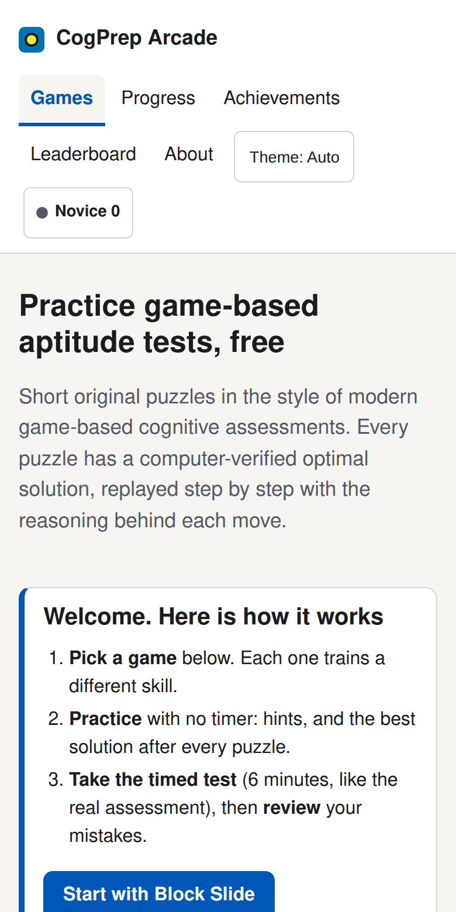
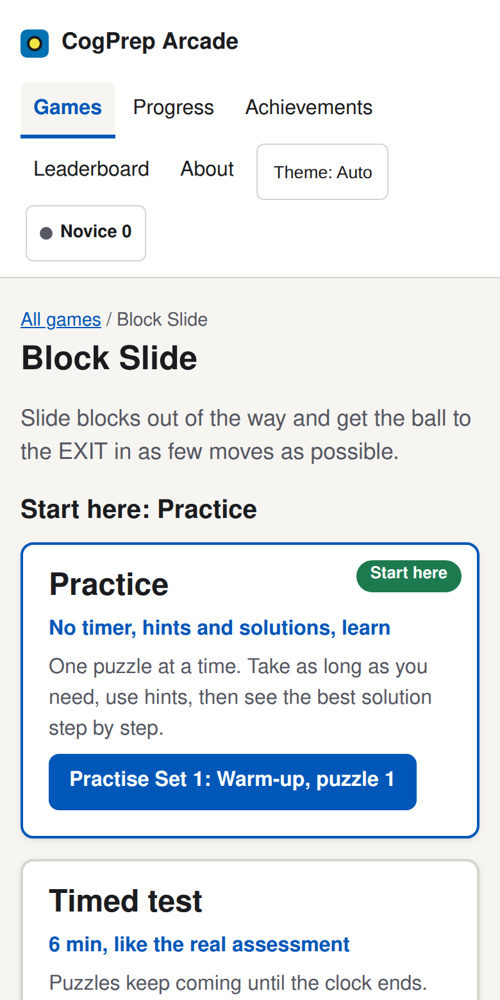
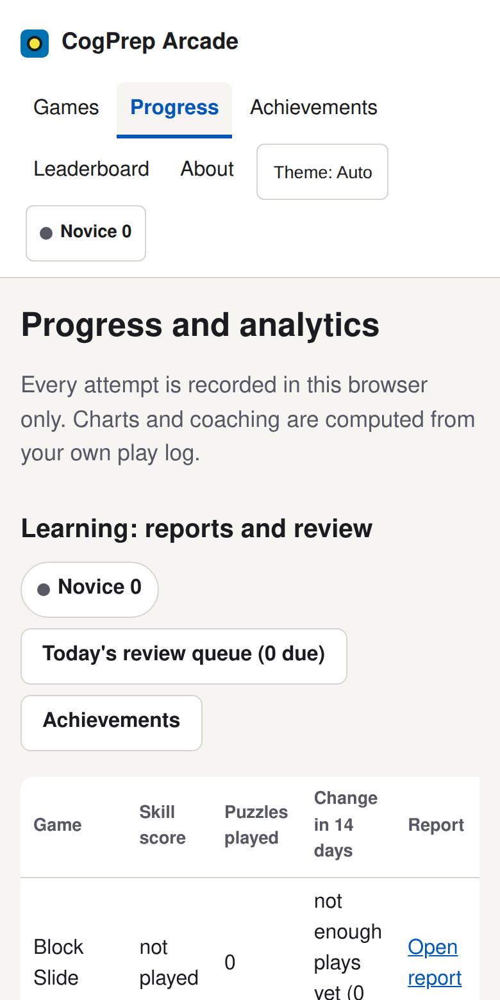

<div align="center">


# CogPrep Arcade

**Free practice for game-based cognitive aptitude assessments.**

Six original reasoning games with computer-verified optimal solutions, a coach that shows what you did versus what you should have done, and progress reports that stay in your browser.

[](#develop)
[](package.json)
[](https://krshnndu.github.io/aptitude-game-practice/)





</div>

## Play

<div align="center">

**[Open CogPrep Arcade](https://krshnndu.github.io/aptitude-game-practice/)**

No account, no install. Works on phones and desktops.

</div>

Independent practice only: not affiliated with Aon, Capgemini or any employer. See [LEGAL.md](LEGAL.md).

## What you get

- **Six games:** Block Slide, Latin Square, Grid Memory, Operator Switch, Digit Equation and Pattern Rule
- **Practice, Timed test and Study mode** for every game: hints and solutions, a 6 minute exam run, or an untimed walkthrough of every puzzle
- **Did vs should:** each puzzle shows your answer beside the optimal one, the first point you diverged and why
- **Coach and review notebook:** mistakes become spaced-repetition review items
- **Progress, achievements and per-game reports** with trends, printable and exportable
- **Leaderboard** across all five sets, opt-in and anonymous
- **End and review** at any moment: partial runs still count toward your progress

Everything you do is stored in your browser. Backup and restore is one JSON file.

| Game | Skill |
|---|---|
| Block Slide | Planning, spatial reasoning |
| Latin Square | Deductive reasoning |
| Grid Memory | Working memory, dual task |
| Operator Switch | Numerical reasoning |
| Digit Equation | Numerical reasoning |
| Pattern Rule | Inductive reasoning |

## Privacy and security

Anonymous operational telemetry only: a random client id, page views, run and item outcomes, device class and coarse timezone. No IP address, name, email, keystrokes or precise location is stored. Details and opt-out in [LEGAL.md](LEGAL.md) and the About page.

The static site talks to a small leaderboard and analytics service that is rate limited, size capped, bound to localhost and reachable only through a tunnel. The stats endpoint requires a bearer token.

## Run locally

```sh
git clone https://github.com/krshnndu/aptitude-game-practice.git && cd aptitude-game-practice
python3 -m http.server 8000    # http://localhost:8000
```

## Develop

Vanilla JavaScript ES modules, no bundler, no dependencies. Tests use `node:test`.

```sh
npm test                 # 531 tests, about 35 s
node tools/verify.mjs    # re-solve every shipped puzzle set
node tools/gen.mjs       # regenerate sets
```

Deploy: push `main`, GitHub Pages serves the repository root. All paths are relative and `.nojekyll` is set.

## Documentation

[Technical details](docs/technical-details.md) · [Learning layer spec](docs/learning-spec.md) · [UX audit](docs/ux-audit.md) ·
Games: [Latin Square](docs/latinsquare.md) · [Grid Memory](docs/gridmemory.md) · [Operator Switch](docs/operatorswitch.md) · [Digit Equation](docs/digitequation.md) · [Pattern Rule](docs/patternrule.md)

## License

MIT · [Legal notice](LEGAL.md)

<sub><b>Credits.</b> README layout modelled on the Pulse project. Built by <a href="https://krishnendu.me?utm_source=cogprep&utm_medium=referral&utm_campaign=readme">Krishnendu Biswas</a>; Termly is a sibling project.</sub>
